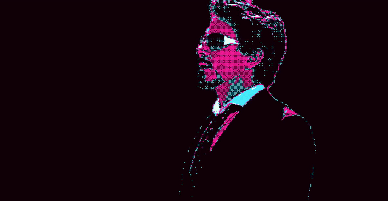

<div align="center">

# 🤖❤️‍🔥 ASCII Video Art

**every frame of a video, rebuilt out of letters and symbols instead of pixels**



</div>

---

### ✨ what is this?
A small coding art project that turns **any video** into ASCII art.
You give it a video, it converts every frame into characters,
and the whole clip plays back as moving text.

I made it for my Iron Man reel 🤖, but it works with **any video you
import**: your own clips, a travel video, a dance, anything.

### 🎬 how it works
1. 🎞️ the video is read frame by frame
2. 🌗 each frame is converted to grayscale (light and dark values)
3. 🔤 every small block of pixels becomes one character:
   dark areas get dense characters, light areas get lighter ones
4. 🖥️ the characters are put together as new frames and played back as a video

### 🛠️ built with
- [Python]
- [library for reading video, e.g. OpenCV]
- [library for images and output, e.g. Pillow / NumPy]

### 🚀 how to use

```bash
# 1. clone this repo
git clone https://github.com/YOUR_USERNAME/YOUR_REPO.git
cd YOUR_REPO

# 2. install the requirements
pip install -r requirements.txt

# 3. run it on your own video
python [your_script.py] [your_video_file]
```

Your converted video is saved in: `[output folder or file name]`

### 🎛️ things you can change
- [character set, e.g. dense or simple]
- [output width: more characters means more detail]
- [black and white or colour output]

*(keep only what your code really supports)*

### 📸 examples
| video | result |
|---|---|
| Iron Man 🤖 |  |
| [add another] |  |

### 📝 note
This is a fan-made art project for learning and fun. Characters and
videos belong to their owners, so I haven't included any original
footage in this repo. Please only convert videos you have the right to use.

---

<div align="center">

*made with ❤️ by [Shravani](https://www.instagram.com/shraisqt)*

</div>
